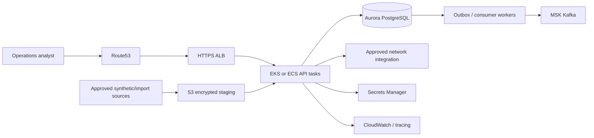

# Hypothetical AWS reference architecture

**Proposal only.** No AWS infrastructure is deployed by this repository, and no employer deployment is implied. The local Docker system remains the implemented environment.

## Why each component exists

| Component | Proposed responsibility | Required design work |
| --- | --- | --- |
| Route53 | Stable DNS and regional routing | Health routing must not promote an unfenced financial writer |
| ALB | TLS termination and HTTP routing | WAF/rate limits, certificate lifecycle, request limits and identity integration |
| EKS or ECS | Run API/frontend/worker workloads | Choose based on operational need; Kubernetes is not required for this monolith |
| MSK | Managed replicated Kafka transport | Partition capacity, retention, TLS/SASL/IAM, lag alerts and replay procedures |
| Aurora PostgreSQL | Authoritative relational financial state | Connection pooling, backups/PITR, migration locks, failover/fencing and performance |
| S3 | Encrypted import/evidence staging | Signed source identity, versioning, retention, checksum/provenance and access controls |
| Secrets Manager | Credential storage and rotation | Least-privilege retrieval, provider/database rotation and audit |
| CloudWatch / OpenTelemetry | Logs, metrics, traces and alerts | PII-safe fields, cardinality bounds, retention and actionable SLO alerts |
| IAM | Workload/service identity | Separate API, worker, migration and operator privileges; avoid broad shared roles |
| VPC/private subnets | Isolate database/broker workloads | Controlled egress, endpoint policies, security groups and private dependency access |

## Deployment and data controls

The API and worker should use separate least-privilege identities. A migration job owns DDL rights; routine application roles should not rewrite journal/history rows or create schema. Use managed keys/TLS, private data services, no public PostgreSQL/Kafka endpoints and explicit approved outbound providers.

Run a reviewable CI artifact through staging, migration rehearsal, integration/failure checks and explicit deployment approval. The current GitHub Actions workflow builds/tests; it is not this deployment pipeline. Introduce signed/versioned images, dependency scanning, rollback/forward recovery and auditable environment configuration before claiming a release process.

Keep the same monetary/idempotency/outbox invariants. Managed infrastructure does not eliminate duplicate Kafka deliveries, network timeout ambiguity, inconsistent source files or authorization mistakes. Capacity tests, recovery drills, incident exercises and access reviews remain required. Multi-region concerns are discussed separately in [MULTI_REGION_DESIGN](MULTI_REGION_DESIGN.md).
