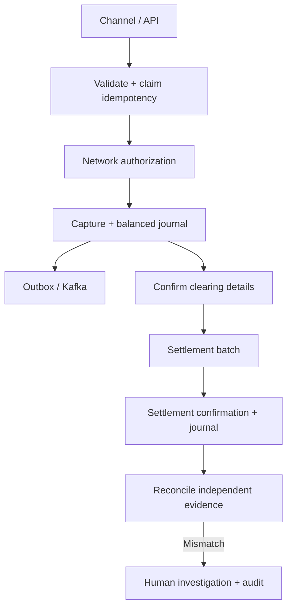

# Banking domain guide

This educational model uses fictional actors and simplified accounting. It is intended to explain controls and failure boundaries, not reproduce any institution's internal system.

## A transaction is an instruction with a lifecycle

A financial transaction records an instruction: who is involved by synthetic reference, what amount and currency, what business date, what type, and which processing stage it reached. Its transaction UUID is an internal identity. An external reference connects independent systems. An idempotency key identifies one submission intent; it is not an account number and is not interchangeable with an event UUID.

## Authorization, capture, clearing and settlement

**Authorization** asks whether the fictional network accepts a proposed transaction. A declined request must not be captured. This project does not implement spendable balances, card holds, fraud scoring or a real issuer decision.

**Capture** records that an authorized payment should proceed financially. It creates an auditable journal instead of silently changing a balance. An authorization alone does not imply settlement.

**Clearing** confirms the details to be settled: transaction reference, amount, currency and business date. A clearing record must match a captured transaction. A malformed or mismatched clearing row is rejected with an import outcome, not silently accepted.

**Settlement** groups eligible cleared transactions and confirms the batch's financial movement. A batch is single-currency, and each transaction can belong to only one batch. The educational `SUBMITTED` step is a local lifecycle marker; there is no connection to real settlement rails.

**Reconciliation** compares independently sourced records after processing. “We sent it” and “the other system reports the same result” are different facts. The engine retains both a mismatch result and the totals that explain the variance.

## Money and currency

Every monetary amount is an integer number of minor units. USD 500.00 is `50000`; USD 450.00 is `45000`; variance is `5000`. Only USD, EUR and GBP are accepted, all with two minor-unit decimals. There is no rounding of a floating input because the API rejects non-integer money. There is no cross-currency sum, conversion, exchange rate or assumption that one EUR equals one USD. Aggregate arithmetic is checked against bounded transaction amounts.

Machine timestamps are UTC instants. A business date is an explicit date supplied for clearing/settlement; it is not inferred from the laptop's timezone. Real banking calendars also need cutoffs, holidays and jurisdictional rules, which are outside this model.

## Double-entry ledger

A debit and credit are accounting sides, not synonyms for “bad” and “good” or universally “minus” and “plus.” Their effect depends on account class. An asset normally increases with a debit; a liability normally increases with a credit.

The simplified payment model uses customer receivable, network payable and cash-clearing ledger accounts. Capture debits customer receivable and credits network payable. Settlement debits network payable and credits cash clearing. A full refund creates the opposite-direction economic effect; a captured reversal appends compensating postings. Read the actual `TransactionService.capture`, `ledger_settle` and reversal methods before describing a posting sequence.

The journal stores equal debit and credit amounts structurally in one row and exposes the two postings through a database view. A row requires a positive amount, different accounts and matching currency. For these full-value financial events, both the helper and a composite database foreign key require the transaction's exact amount/currency. PostgreSQL and SQLite triggers reject journal updates/deletes; no API rewrites a journal or deletes its history. This paired representation deliberately supports common two-leg cases. A production general ledger needs multi-leg journals, accounting periods, account-class controls, trial balances, close procedures and least-privilege database roles; privileged schema administrators remain outside the application guarantee.

A transaction ledger records financial events. An account's spendable balance additionally requires opening balances, holds, pending activity, overdraft rules, effective dates and reconciliation. This project does not infer funding availability from the existence of journals.

## Reversal and refund

A **reversal** cancels an authorized/captured transaction before clearing. An authorized reversal has no captured financial journal to unwind; a captured reversal appends a compensating journal. Replaying a reversal must not create additional financial effects.

A **refund** follows settlement. It is a new, full-value transaction linked to the original, with its own authorization/capture/clearing/settlement and opposite settlement direction. A database uniqueness rule permits only one refund child. The original's status records that the full refund was captured. Partial refunds, multiple refund allocations and disputes are not implemented.

## Exceptions and operational controls

An exception is a work item with evidence, severity, status, assignment, notes and history. `RESOLVED` means an operator recorded an outcome. It does not mean the system invented a balancing entry or erased the discrepancy. Financial corrections need explicit approved business commands and new ledger history.

Controls connect requirements to invariants: unique idempotency claims stop duplicate submissions, allowed transitions stop impossible processing sequences, balanced journals preserve accounting equality, unique settlement membership prevents double settlement, and version checks stop analysts overwriting one another's resolution notes.

History answers who requested a change, when it occurred, what state preceded/followed it, why, and which request correlated to it. Operational logs answer a different question: how the application processed the request. Logs exclude customer content and credentials; durable history survives log retention.
